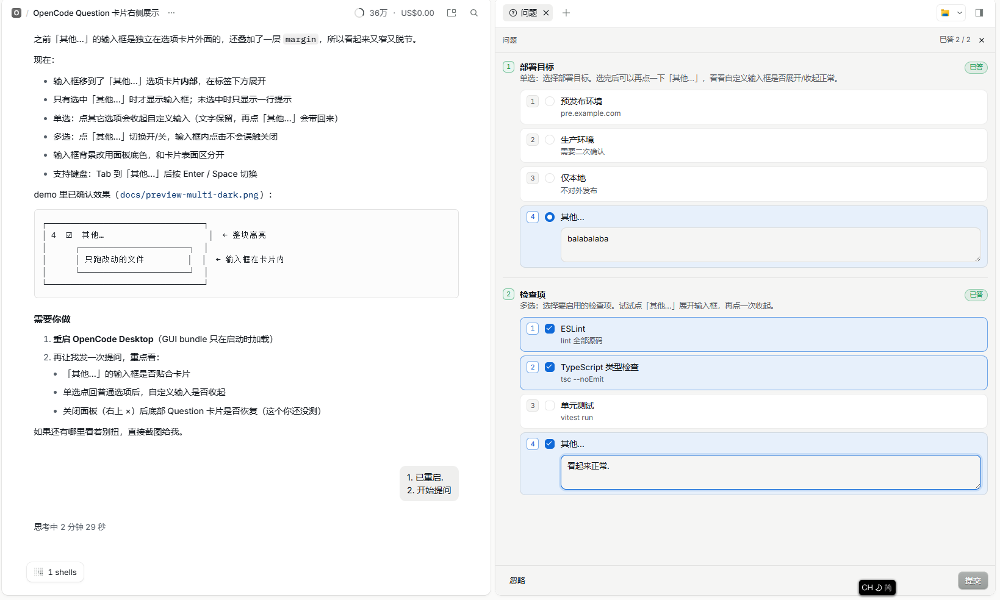

# opencode-plugin-ask-questions-in-right-panel

Moves OpenCode Desktop's question card out of the bottom composer and into the right side panel, so it no longer covers the reply or plan you are reading.

<p align="center">
  
</p>

<p align="center">
  <sub>A real Desktop session: every question expanded, the custom answer inside the "Other…" card, and no bottom dock covering the reply.</sub>
</p>

## What it does

- Opens the **Questions** side tab automatically when a question arrives
- Shows every question of a form in one **vertical list**, all expanded
- Answers each question on its own; the header shows `n of N answered` and answered questions are marked
- Supports single choice, multi choice, option descriptions, custom answers (`custom`) and free-text questions
- Queues questions from the routed session and its running subagents, labelled with their source session
- Hides the host's bottom question dock while the panel is visible; closing the panel, hiding the side region or switching sessions restores it
- Does nothing below 768px: the host's bottom card stays in charge there
- Follows the host's `--v2-*` theme tokens; Chinese and English copy

## Requirements

- OpenCode Desktop `2.2.x` (GUI plugin API from `@opencode/plugin@2.2.1`)
- Relies on the host's `data-component="dock-prompt"` / `data-kind="question"` selectors to hide the bottom card

## Install

Package:

```text
@devdengchao/opencode-plugin-ask-questions-in-right-panel
```

Add it to the global `~/.config/opencode/opencode.jsonc` (on Windows usually
`C:\Users\<user>\.config\opencode\opencode.jsonc`):

```jsonc
{
  "$schema": "https://opencode.ai/config.json",
  "plugins": [
    "@devdengchao/opencode-plugin-ask-questions-in-right-panel"
  ]
}
```

Pin a version if you prefer:

```jsonc
"plugins": [
  "@devdengchao/opencode-plugin-ask-questions-in-right-panel@0.1.0"
]
```

Restart Desktop if the GUI does not reload, or check **Settings > Extensions > Plugins**.

### From source

```bash
git clone git@github.com:DevDengChao/opencode-plugin-ask-questions-in-right-panel.git
cd opencode-plugin-ask-questions-in-right-panel
npm ci
npm run build
```

The build writes `dist/gui.cjs`. Point the config at the checkout:

```jsonc
{
  "plugins": [
    "file:///E:/my/open-source/opencode-plugin-ask-questions-in-right-panel"
  ]
}
```

## Usage

The panel opens by itself. While a question is pending you can also reopen it from the side region's **+** menu.

- **Answer**: pick options or type a custom answer, then **Submit** (`Ctrl/⌘ + Enter`)
- **Dismiss**: the button or `Esc`, the same as the host's cancel
- **Close the panel**: the × on the tab restores the bottom dock; that question will not reopen, the next one will
- **Several questions**: all expanded, scroll through them; answered ones are marked
- **Several pending forms**: switch from the queue at the top

## How it works

Only public GUI plugin APIs are used:

- `Panel` (`region: "side"`, `transient`) registers the side tab
- `ctx.sessions.current()` plus `session.server.data.session.form.{list,sync,reply,cancel}` read and answer forms
- `ctx.layout.open/state/close/narrow` drive the side region and the narrow-screen fallback
- One `createEffect` adds `data-aqrp-dock` to `<html>` while the panel is visible and a question is pending; CSS hides the bottom card, and removing the attribute restores it
- Forms are matched by `metadata.kind === "question"`, walking the session tree in the same order as the host's `session-request-tree`

No host files are patched and no host DOM is moved.

## Limitations

- Hiding the dock depends on the host's internal `data-component` / `data-kind` names; a major rename degrades to "dock not hidden" (two cards), never a crash
- The `question` tool call card in the timeline is not a dock and stays as is
- `form.sync` runs only for the routed session and its running subagents, matching the host
- The host's collapse/expand motion is not reproduced

## Development

```bash
npm ci
npm run typecheck
npm test
npm run build
npm run dev      # vite build --watch
npm run demo     # preview the panel scenarios at http://localhost:5173
```

Layout:

```text
src/index.ts            server plugin, declares the id
src/gui.tsx             Panel / Style / auto-open / dock hiding
src/question-panel.tsx  the panel UI
src/forms.ts            tree walk, field extraction, answer building (unit tested)
src/labels.ts           Chinese and English copy
src/styles.css          panel styles and the dock-hiding rule
tests/forms.test.ts     vitest
```

## License

MIT
